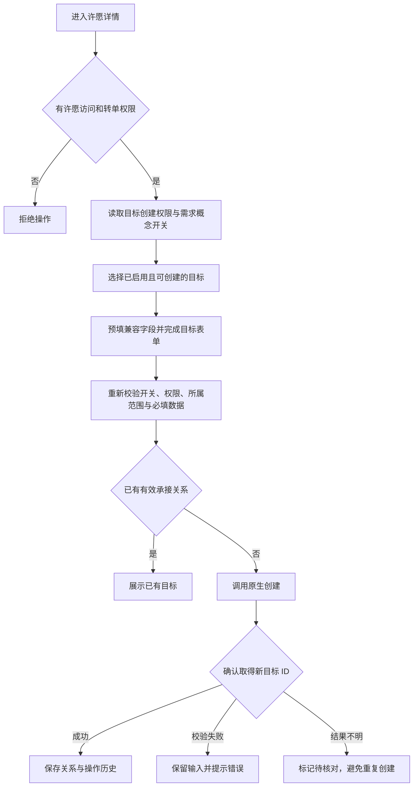
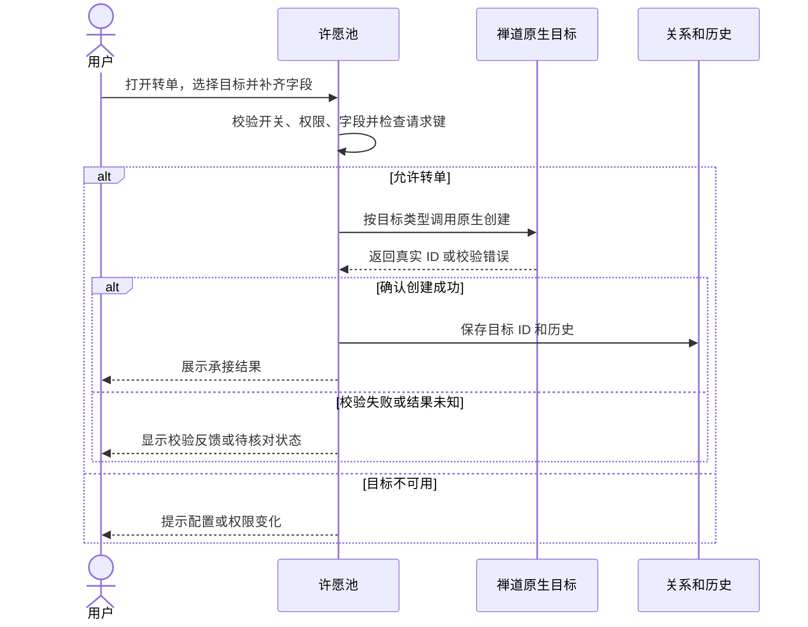

# 许愿池转单设计

许愿可以直接转 Bug、待办、研发需求和任务。启用相应系统概念后，也可以转业务需求和用户需求。当前部署范围不包含反馈、工单模块。

## 业务流程

## 目标字段与原生创建入口

| 目标 | 原生创建入口 | 表单字段与转换规则 |
|---|---|---|
| Bug | `bug.create` | 产品 ID、标题和 `openedBuild[]` 必填。主干用 `trunk`，实际构建用 ID；候选按目标产品、分支和执行上下文加载。许愿正文预填 `steps`，优先级预填 `pri`，严重程度和 Bug 类型独立配置。 |
| 待办 | `todo.create` | 名称取标题，日期默认当天，描述来自许愿。适配层设置 `type=custom`、`status=wait`、`pri` 和私有性；待办使用当前账号的权限。可用返回 `id` 的 JSON 创建形式。 |
| 研发需求 | `story.create`，`storyType=story` | 产品、标题与当前实例启用的必填字段。正文 → `spec`、验收标准 → `verify`，预填类别、优先级、来源和备注。按站点规则校验层级和评审人。多范围使用 `branches[]`、`modules[]`、`plans[]`，创建孪生需求时核验并保存全部目标 ID。 |
| 业务需求 | `epic.create`，委托 `story.create` 的 `epic` 类型 | 按业务需求配置校验层级、评审规则和字段。平台或分支、模块、计划为单组，使用 `branch`、`module`、`plan`。来源有多组范围时预填第一组并允许重新选择。 |
| 用户需求 | `requirement.create`，委托 `story.create` 的 `requirement` 类型 | 按用户需求配置校验层级、评审规则和字段。使用单组平台或分支、模块、计划。 |
| 任务 | `task.create` | 执行 ID、任务名称、任务类型必填。未选模块或关联需求时显式传入 `module=0`、`story=0`；省略会使当前基线尝试写入 NULL。执行必须可访问并与业务产品关联；指派候选按执行范围加载。验证开始／截止日期，复用当前执行的模块、关联需求和看板条件规则。 |

业务需求读取 `config->enableER`，用户需求读取 `config->URAndSR`。在生成菜单和创建提交时分别读取当前配置，并检查目标模块的创建权限、产品权限和可用层级。原型使用示例开关，可通过 `?enableER=0&URAndSR=0` 测试禁用态，正式插件从禅道服务端读取。 [原生菜单开关](../../module/common/lang/menu.php#L901) · [需求层级](../../module/story/model.php#L5575)

每次提交记录 `wishID`、`targetType`、`requestKey`。使用原生目标创建入口，关系指向真实目标 ID。转单关系支持一种类型的多个孪生目标，操作键保证重试时不重复创建。

[Bug 创建](../../module/bug/control.php#L252) · [待办创建](../../module/todo/control.php#L37) · [需求创建](../../module/story/control.php#L53) · [任务创建](../../module/task/control.php#L44)

## 插件数据与状态

| 记录 | 建议字段 |
|---|---|
| 许愿 `wishpool_wish` | `id`、`product`、`module`（可空）、`title`、`description`、`priority`、`status`、`assignedTo`、`createdBy`、`createdAt`、`updatedBy`、`updatedAt`、`closedBy`、`closedAt`、`closeReason`、`duplicateWishID`（可空）、`deleted`。业务允许外部提交时再增加 `source` 和 `requesterName`。 |
| 转单关系 `wishpool_conversion` | `id`、`wishID`、`targetType`、`targetID`（创建前为空）、`targetProductID`（可空）、`targetExecutionID`（可空）、`requestKey`、`state`、`createdBy`、`createdAt`、`updatedAt`。记录简短错误码或失败原因时避免保存凭证及敏感正文。 |

表使用实例的数据库前缀。第一版建议一条许愿可以转多个类型，每类最多发起一次有效转单，研发需求的同次孪生创建允许多个目标，用数据库唯一键保证并发一致性。许愿状态沿用开放、处理中、关闭，转单状态由各条关系记录单独展示，成功转单后由用户决定是否关闭许愿。单独记录目标类型与 ID，支持原生模块和插件分别管理生命周期；用户只有拥有目标读取权限时才显示详情链接。

**一致性**采用 `pending → succeeded / failed / needs_reconcile`。明确校验失败且目标未创建时可重新提交。超时或目标已创建而关系写入失败时保留待核对状态；确认目标 ID 或确认无对象后再推进。只有适配器和插件写入确实共享同一事务且目标创建无外部副作用时，才承诺原子提交。

## 关闭与激活

研发需求的手动关闭表单要求选关闭原因，选「重复」时再要求填写重复需求。普通备注按实例配置决定是否必填。原生原因字典包含「已拆分」，手动关闭表单移除该项，草稿还会移除「已取消」。发现未完成任务时，原生表单在提交前要求二次确认。 [关闭控制器](../../module/story/control.php#L1053) · [原因字典](../../module/story/lang/zh-cn.php#L290) · [关闭校验](../../module/story/js/close.ui.js)

| 许愿池关闭原因 | 适用场景 |
|---|---|
| 已完成 `done` | 已直接处理或承接工作完成，负责人确认可以结案 |
| 重复 `duplicate` | 与同产品另一条可访问许愿重复，必须选择那条许愿，不能指向自己 |
| 延期 `postponed` | 暂缓处理，备注可补充恢复条件 |
| 不做 `willnotdo` | 评估后决定不采纳 |
| 已取消 `cancel` | 提出者撤回或办理取消 |
| 设计如此 `bydesign` | 现有行为符合设计，已记录处理意见 |

待评估和跟进中的许愿均可关闭。插件无草稿态，也无原生需求拆分动作。关闭保存 `closeReason`、`closedBy`、`closedAt`，重复时额外保存 `duplicateWishID`，备注和变更写入历史。切走「重复」时清除重复项。关闭态的指派显示为「已关闭」，历史保留经办信息。存在未完成的承接任务时需明确确认，承接单据继续独立流转。正式实现应在服务端复核关闭权限、状态和重复对象的产品及可见性。

激活时按原生交互提供指派和备注，默认指派给关闭人。许愿池回到「跟进中」，清除本次关闭字段，保留关闭历史、承接关系和激活日志。研发需求原生激活会另外根据需求历史计算恢复状态。 [激活表单](../../module/story/ui/activate.field.php) · [激活模型](../../module/story/model.php#L2355)

## 搜索下拉与系统字典

研发需求的动态候选由禅道模型读取当前实例数据库。许愿池按相同的数据权限和依赖关系取数，使用原生 ZIN `picker`、`modulePicker` 和 `mailto`。原型展示现有字段的搜索交互，其余字段在对应场景启用时也统一支持搜索。 [字段组件](../../module/story/ui/create.field.php) · [原生候选加载](../../module/story/zen.php#L529)

| 字段 | 数据来源与搜索范围 |
|---|---|
| 所属产品 | 产品模型，只查询当前用户可提报或转入的产品，按产品名称或 ID 搜索。 |
| 平台／分支、模块、计划 | 分支模型、模块树、产品计划模型。按产品及平台／分支限制候选，模块按名称或完整父路径搜索。切换上级后清除失效值，保留已填正文。 |
| 父需求、重复许愿 | 父需求使用原生产品需求候选，按标题或编号搜索。重复许愿使用当前产品可见的许愿，并排除自身。 |
| 指派给、评审人、抄送 | 用户和产品评审人模型，按显示名或账号搜索。指派、评审和抄送分别使用各自的候选权限。评审、抄送按原生规则支持多选。 |
| 层级、区域、泳道 | 层级使用研发需求的 `getGradePairs` 和站点层级规则。区域、泳道仅适用启用看板的执行上下文，泳道随区域刷新。 |
| 转单时的版本和执行 | 使用各目标模块候选。版本按目标产品及执行范围查询，执行按关联产品和权限查询。 |

类别、优先级、来源复用界面加载后的 `story.categoryList`、`story.priList`、`story.sourceList`，保存字典键并显示当前实例的标签。字典通过禅道自定义配置覆盖，插件无需另建字典表。原生「来源」描述客户、客服等来源主体，「电话、群聊、拜访」写入「来源备注」。需要把这些渠道作为可统计选项时，可由管理员在现有来源字典中补充所需选项，并明确其口径。 [研发需求字典](../../module/story/lang/zh-cn.php#L309) · [自定义设置](../../module/custom/lang/zh-cn.php#L131) · [自定义语言加载](../../module/custom/model.php#L21)

正式实现按名称、编号或账号搜索，长列表由服务端分页。编辑回显保留历史值及其标签，失效值不允许作为新选项。提交时重新校验候选权限和产品归属。原型使用本地示例数据和原生默认字典示例。

### 产品范围与模块路径

- 普通产品显示「所属模块」和「所属计划」。多平台产品显示「所属平台与所属模块」，多分支产品显示「所属分支与所属模块」。每行独立记录平台／分支、模块和计划；新增行时排除已选范围。切换产品重置全部范围；切换某一行的平台或分支，仅重置该行的模块和计划。 [研发需求字段](../../module/story/ui/create.field.php) · [多范围组件](../../lib/zin/wg/twinsstory/v1.php) · [联动实现](../../lib/zin/wg/twinsstory/js/v1.js)
- 模块候选显示完整路径，例如 `/主干/销售/新建订单/订单导入`。根模块显示 `/`，普通产品路径省去平台或分支前缀。选中范围可以看到自己的模块和主干共享模块，按完整路径或模块 ID 搜索并以 ID 保存。正式实现应直接使用 `tree->getOptionMenu` 返回的键值对。 [模块路径生成](../../module/tree/model.php#L164)
- 原型用 `scopes` 演示多行回显与转研发需求预填。正式接入时将各行映射到原生的 `branches[]`、`modules[]`、`plans[]`。原型的转单编号为模拟结果，正式接入需要核验原生多范围创建时返回的全部目标 ID 和关联结果。

列表左侧使用模块树，节点只显示本级名称，通过缩进、连线和展开／收起来表达层级。选择父模块时纳入其子模块，选择叶子时按模块 ID 筛选。表单选择器继续显示和搜索完整路径。 [研发需求侧栏](../../module/product/ui/browse.html.php#L52) · [模块下拉路径](../../module/tree/model.php#L164)

## 前端组件复用

正式插件全部使用禅道现有的 ZIN 页面框架、ZUI 主题和控件。列表使用 `featureBar`、`moduleMenu` 与 `dtable`，新建和编辑使用 `formGridPanel`／`detailForm`，详情和工具栏使用 `detail`，转单与关闭使用原生 `modal`。搜索、模块、人员、富文本、附件、日期分别用已有控件，样式跟随实例主题。插件只编写字段配置、候选加载、状态与提交规则。 [列表组件](../../module/product/ui/browse.html.php#L509) · [研发需求新建表单](../../module/story/ui/create.html.php) · [研发需求详情](../../module/story/ui/view.html.php#L292)

数据库候选和来源、类别等可配置字典使用原生 `picker`，在控件的原位置搜索，菜单只列选项且与控件等宽。优先级、严重程度等固定短选项使用原生单选样式，显示选项供直接点选。字典值仍沿用禅道的键。 [Picker 参数](../../lib/zin/wg/picker/v1.php) · [Radio 组件](../../lib/zin/wg/radio/v1.php)

交互原型随目录附带同版本的 ZUI JavaScript、CSS、默认主题和字体，来源为仓库的 `www/js/zui3`。保留 `prototype.html` 与同级 `zui/` 目录即可打开。也可从原型目录启动本地 HTTP 服务。原型页面结构与模拟状态用于评审，正式页面由上述 ZIN 组件渲染。

## 本地验收

在禅道 22.7 开源版使用 ERP 测试产品及关联执行，通过原生入口创建了 Bug、待办、研发需求、业务需求、用户需求和任务，并查询各自数据库表核对 ID、类型及关键字段。业务需求和用户需求使用各自控制器；验证 GET 形式调用时不能省略前面的路由位置参数然后直接拼接 `storyType`。任务复测显式提交根模块与无关联需求的零值。原型本身仅演示字段交互、开关和承接结果，正式插件的权限判断、落库绑定及关联恢复仍需实现。

多平台研发需求复测创建了主干及示例平台两条记录，主 ID 为 6，另一条为 7。原生返回主 ID，数据库中的 `twins` 记录了双向关联。正式转单适配器需按该关联取回所有成功创建的需求 ID。浏览器回归覆盖列表筛选、创建及编辑、详情、指派、六种可用目标、关闭确认、激活、两项需求开关关闭及窄屏。

## 附件

提报和编辑用禅道原生 `fileSelector`，支持同时选多个文件、拖放、编辑回显及移除。详情用 `fileList` 显示并下载。正式插件保存由禅道文件模块管理，按对象类型和 ID 关联；上传、读取、移除按文件权限与实例大小限制执行。

转 Bug、任务及三类需求时，用户可以勾选需要携带的许愿附件，也可以补传目标附件。默认不勾选任何来源文件。正式提交前校验源文件读取权限和目标上传权限，目标创建后通过原生文件模块绑定。待办的原生表单无附件入口，相关材料可从来源许愿查看。原型文件仅保存在浏览器内存，验证选择、移除和下载交互。 [需求创建组件](../../module/story/ui/create.field.php#L136) · [需求附件详情](../../module/story/ui/view.html.php#L85) · [Bug 附件](../../module/bug/ui/create.field.php#L94) · [任务附件](../../module/task/ui/create.field.php#L30)

附件回归覆盖多选、详情下载、编辑移除和转单按选携带。本地禅道使用 multipart 表单分别创建了带附件的 Bug、任务、研发需求、业务需求和用户需求，核对 `zt_file` 中的对象类型、对象 ID 和文件大小。
