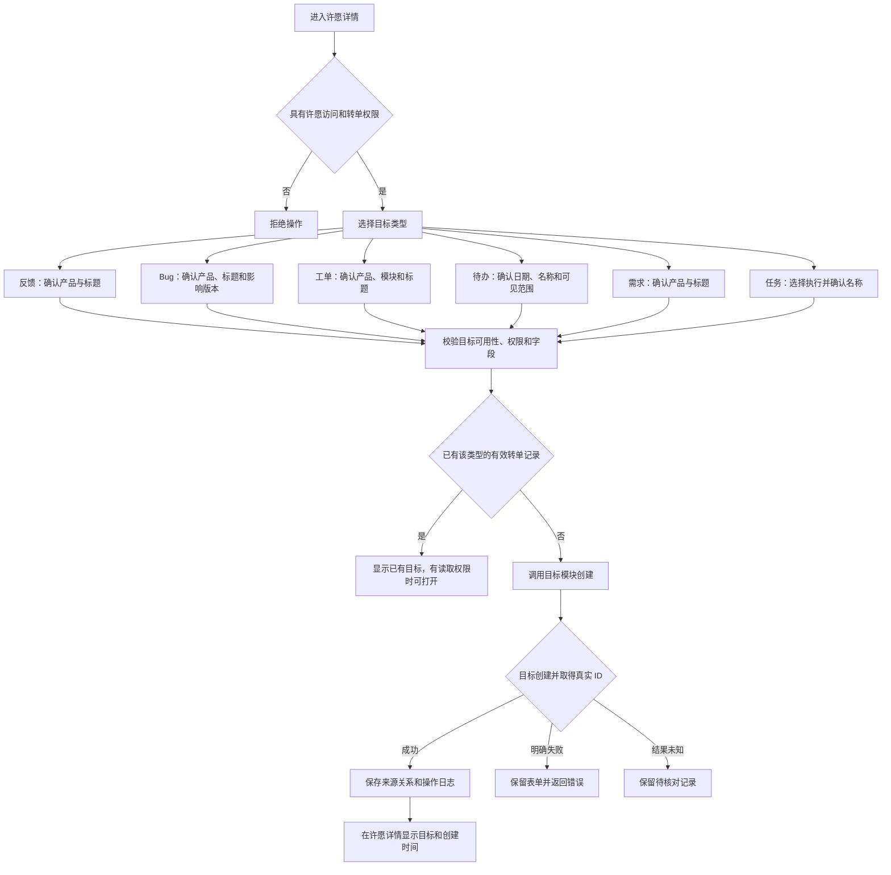
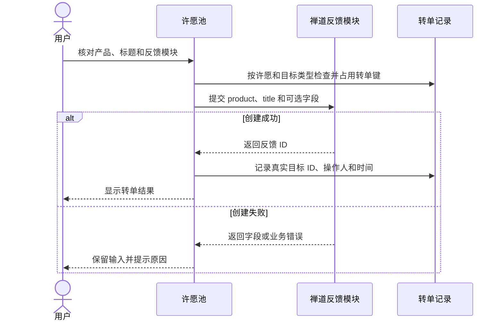
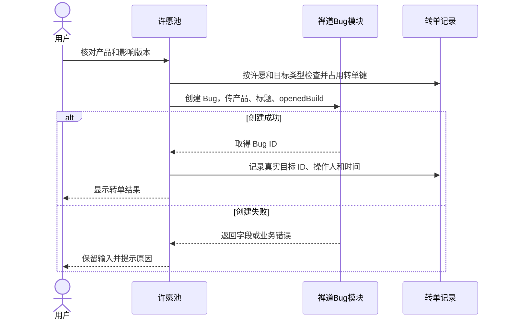
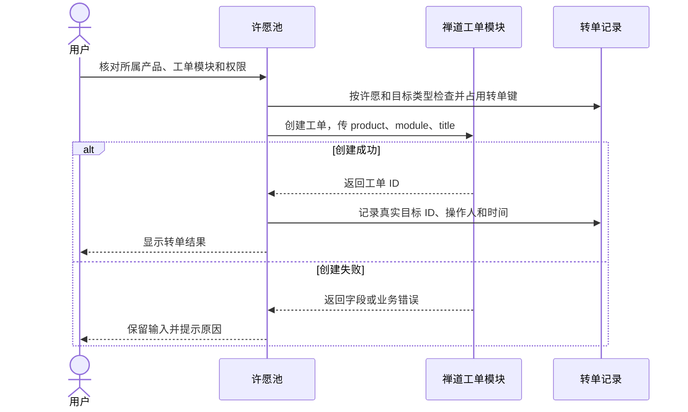
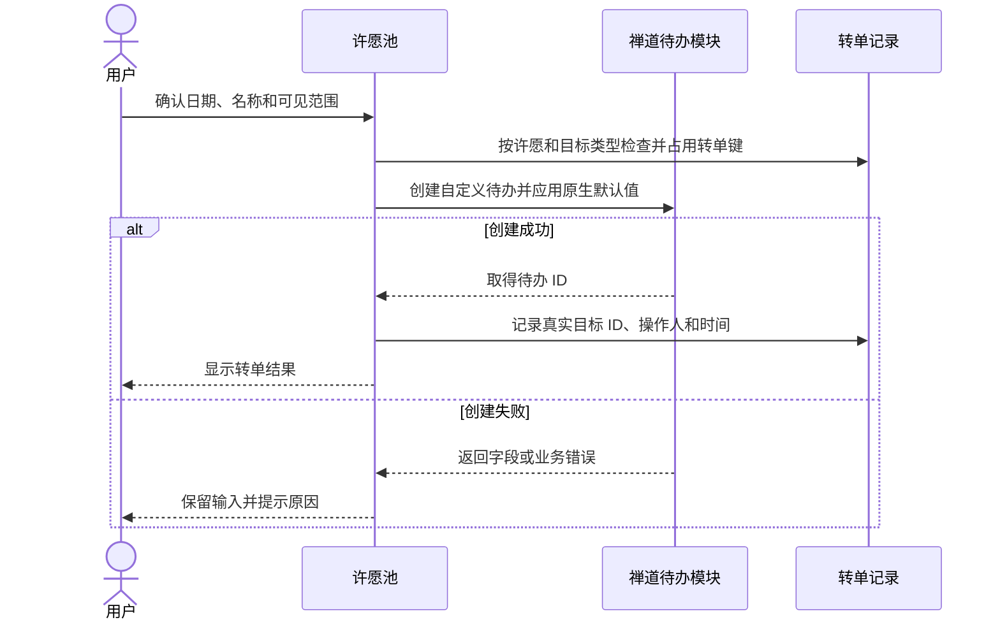
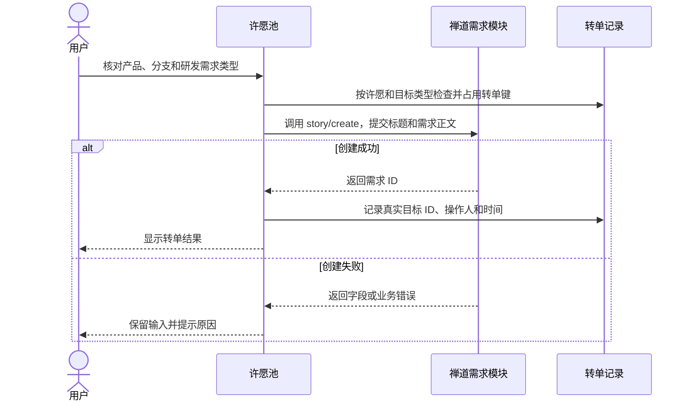
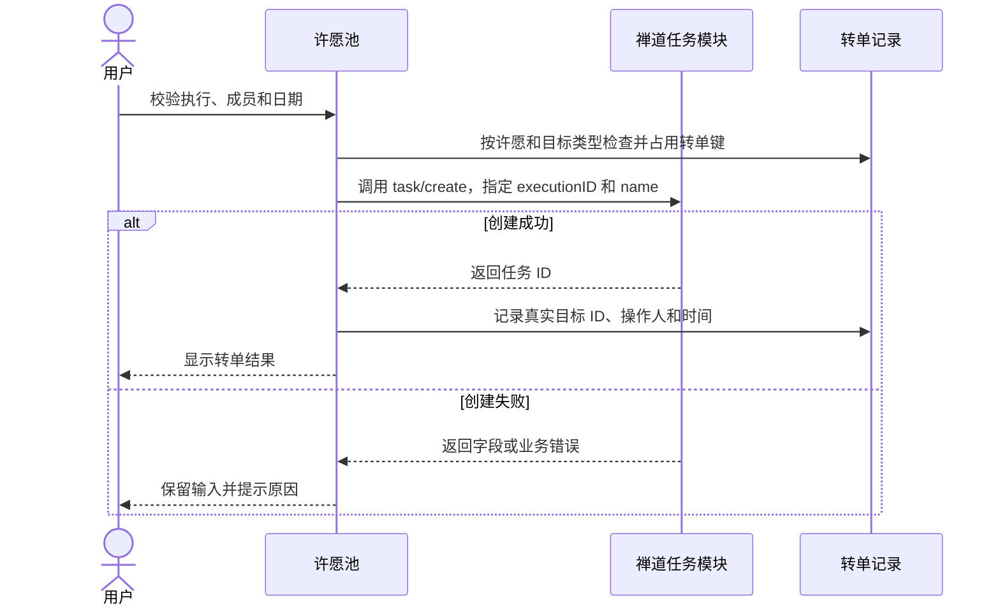

# 许愿池转单设计

六个动作均以一条许愿为起点，用户直接选择目标。转反馈是可选去向，转 Bug、工单、待办、需求、任务可以直接发起。「需求」默认指产品研发需求 `story`。

## 业务流程

## 六条链路需要哪些字段

每次提交都需要许愿 ID `wishID`、目标类型 `targetType`、本次转单的幂等键 `requestKey`。源产品、标题、正文和优先级从服务端读取；操作人取当前会话。表中「文档必填」来自反馈 v2 文档，用于对照；执行时还需要应用目标模块实际启用的必填项和配置。

| 目标 | 参考接口 | 文档必填 | 预填和补录 |
|---|---|---|---|
| 反馈 | 117 `POST /feedbacks` | `product` 产品 ID、`title` 标题 | 预填源产品、标题、正文 → `desc`。可补 `module`、`type`、`feedbackBy`、`source`。提交账号和外部反馈者名称分别处理。 |
| Bug | 118 `POST /feedbacks/:feedbackID/bugs` | `productID` 产品 ID、`title` 标题、`openedBuild` 影响版本数组 | 预填产品、标题、优先级 `pri`。正文可作为 `steps` 初稿，由用户确认复现步骤、实际结果和预期结果。影响版本用 `trunk` 或有效构建 ID；可选 `severity`、`type`。 |
| 工单 | 119 `POST /feedbacks/:feedbackID/tickets` | `product` 产品 ID、`module` 模块 ID、`title` 标题 | 预填产品、标题、正文 → `desc`。按工单模块树选择有效模块，可选 `type`；源许愿的模块 ID 只有在目标模块树中有效时才预填。 |
| 待办 | 120 `POST /feedbacks/:feedbackID/todos` | `date` 日期、`name` 名称 | 日期默认当天，名称取标题。原生表单还需 `type`、`status`、`pri`，由适配层按待办配置提供，使用自定义待办类型。正文映射 `desc`；指派和私有性走目标表单。 |
| 需求 | 121 `POST /feedbacks/:feedbackID/stories` | `productID` 产品 ID、`title` 标题 | 预填产品、标题、正文 → `spec`、`pri`。可选 `category`，按目标配置处理分支、模块及评审字段。 |
| 任务 | 122 `POST /feedbacks/:feedbackID/tasks` | `executionID` 执行 ID、`name` 名称 | 用户选择有权限且与业务产品相符的执行。标题 → `name`、正文 → `desc`。可选 `type`、`assignedTo`、`estStarted`、`deadline`；同时填写两日期时，截止不得早于开始。 |

以上参考接口中的 `:feedbackID` 是真实原生反馈 ID。许愿直转时调用对应目标创建入口，用插件关系表保存来源。若用户另外在反馈模块发起「反馈转单」，才使用新建反馈的原生 ID。各目标的类型枚举独立校验，附件、通知和联系人信息由用户确认后按目标权限处理。

## 转单时序图

以下六张图共用相同约定。许愿池先校验源记录、当前用户权限与目标字段，再占用转单键。图中的「记录关系」仅在拿到真实目标 ID 后执行。验证错误保留表单；已存在的请求返回已有状态；创建结果不明时先核对目标，防止重试产生重复对象。

### 许愿转反馈

### 许愿转Bug

### 许愿转工单

### 许愿转待办

### 许愿转需求

### 许愿转任务

## 插件数据与状态

| 记录 | 建议字段 |
|---|---|
| 许愿 `wishpool_wish` | `id`、`product`、`module`（可空）、`title`、`description`、`priority`、`status`、`assignedTo`、`createdBy`、`createdAt`、`updatedBy`、`updatedAt`、`closedBy`、`closedAt`、`closeReason`、`duplicateWishID`（可空）、`deleted`。业务允许外部提交时再增加 `source` 和 `requesterName`。 |
| 转单关系 `wishpool_conversion` | `id`、`wishID`、`targetType`、`targetID`（创建前为空）、`targetProductID`（可空）、`targetExecutionID`（可空）、`requestKey`、`state`、`createdBy`、`createdAt`、`updatedAt`。记录简短错误码或失败原因时避免保存凭证及敏感正文。 |

表使用实例的数据库前缀。第一版建议一条许愿可以转多个类型，每类最多保留一个有效目标，用数据库唯一键保证并发一致性。许愿状态沿用开放、处理中、关闭，转单状态由各条关系记录单独展示，成功转单后由用户决定是否关闭许愿。单独记录目标类型与 ID，支持原生模块和插件分别管理生命周期；用户只有拥有目标读取权限时才显示详情链接。

**一致性**采用 `pending → succeeded / failed / needs_reconcile`。明确校验失败且目标未创建时可重新提交。超时或目标已创建而关系写入失败时保留待核对状态；确认目标 ID 或确认无对象后再推进。只有适配器和插件写入确实共享同一事务且目标创建无外部副作用时，才承诺原子提交。

**Bug 和待办的 ID** 在参考文档 118、120 的返回定义中未列出。插件适配器要实测拿到目标模型返回的 ID，再标记为成功；只收到 `status: success` 时不得猜测 ID。工单、反馈在当前开源环境中需先确认模块和授权可用，入口按能力显示，服务端也做相同检查。其余四个动作接入开源模块后还需逐一做真实创建验证。

## 核对来源

- 反馈 v2 文档数据，API ID 117–122。 [db/api/v2/api](../../db/api/v2/api#L29457)
- 转 Bug 单独映射至 Bug 创建；其余转单路由和字段注入见反馈路由。 [Bug 路由](../../config/apiv2.php#L191) · [反馈路由](../../config/apiv2.php#L318)
- 原生创建字段和默认值。 [Bug 表单](../../module/bug/config/form.php#L10) · [待办表单](../../module/todo/config/form.php#L13) · [需求创建](../../module/story/control.php#L53) · [任务创建](../../module/task/control.php#L44)
- 原生反馈记录通过自身字段保存处理结果；插件用关系表承载多种去向。 [反馈表](../../db/zentao.sql#L2687) · [原生需求池表](../../db/zentao.sql#L14937)

## 关闭与激活

研发需求的手动关闭表单要求选关闭原因，选「重复」时再要求填写重复需求。普通备注按实例配置决定是否必填。原生原因字典包含「已拆分」，手动关闭表单移除该项，草稿还会移除「已取消」。发现未完成任务时，原生表单在提交前要求二次确认。 [关闭控制器](../../module/story/control.php#L1053) · [原因字典](../../module/story/lang/zh-cn.php#L290) · [关闭校验](../../module/story/js/close.ui.js)

| 许愿池关闭原因 | 适用场景 |
|---|---|
| 已完成 `done` | 已直接处理或承接工作完成，负责人确认可以结案 |
| 重复 `duplicate` | 与同产品另一条可访问许愿重复，必须选择那条许愿，不能指向自己 |
| 延期 `postponed` | 暂缓处理，备注可补充恢复条件 |
| 不做 `willnotdo` | 评估后决定不采纳 |
| 已取消 `cancel` | 提出者撤回或办理取消 |
| 设计如此 `bydesign` | 现有行为符合设计，已记录处理意见 |

待评估和跟进中的许愿均可关闭。插件无草稿态，也无原生需求拆分动作。关闭保存 `closeReason`、`closedBy`、`closedAt`，重复时额外保存 `duplicateWishID`，备注和变更写入历史。切走「重复」时清除重复项。关闭态的指派显示为「已关闭」，历史保留经办信息。存在未完成的承接任务时需明确确认，承接单据继续独立流转。正式实现应在服务端复核关闭权限、状态和重复对象的产品及可见性。

激活时按原生交互提供指派和备注，默认指派给关闭人。许愿池回到「跟进中」，清除本次关闭字段，保留关闭历史、承接关系和激活日志。研发需求原生激活会另外根据需求历史计算恢复状态。 [激活表单](../../module/story/ui/activate.field.php) · [激活模型](../../module/story/model.php#L2355)
